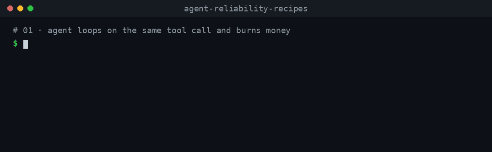

# agent-reliability-recipes

**Your [Vercel AI SDK](https://ai-sdk.dev) agent worked in the demo. Here is how it fails in production — and the fix, as code you can run.**

Each recipe is one real failure, shown inside a real AI SDK agent loop (`ToolLoopAgent`, tools, `stopWhen`): the broken code, the fixed code, and tests that prove the fix. A mock model stands in for the LLM, so everything runs offline with **no API key**.



<sub>Rendered from the real output of `npm run demo:01`, `demo:02` and `demo:03`. Regenerate with `python3 scripts/make-gifs.py`.</sub>

## Recipes

| # | Failure | Status |
| --- | --- | --- |
| [01](recipes/01-loop-and-cost-guard) | Agent loops on the same tool call and burns money | ✅ Ready |
| [02](recipes/02-idempotent-tool-calls) | Retry after a timeout sends the email / charges the card twice | ✅ Ready |
| [03](recipes/03-retry-storm) | Retry storm: blind retries on errors that will never succeed | ✅ Ready |
| 04 | Tool output is truncated or malformed, and the agent "succeeds" anyway | Planned · [#1](https://github.com/msohailkhandev/agent-reliability-recipes/issues/1) |
| 05 | Long run is killed by the platform timeout halfway through | Planned · [#2](https://github.com/msohailkhandev/agent-reliability-recipes/issues/2) |
| 06 | Agent fails silently instead of handing off to a human | Planned · [#3](https://github.com/msohailkhandev/agent-reliability-recipes/issues/3) |
| 07 | A prompt or model change quietly breaks a working agent | Planned · [#4](https://github.com/msohailkhandev/agent-reliability-recipes/issues/4) |
| 08 | Agent can't understand your API's errors | Planned · [#5](https://github.com/msohailkhandev/agent-reliability-recipes/issues/5) |

## Quick start

Requires Node 22.12 or newer.

```bash
git clone https://github.com/msohailkhandev/agent-reliability-recipes.git
cd agent-reliability-recipes
npm install
npm run demo:01   # loop + cost burn: the failure and the fix
npm run demo:02   # double email after a timeout
npm run demo:03   # retry storm
npm test          # run every recipe's tests
```

## How the recipes are written

- **One failure per recipe.** Its README starts with what goes wrong, in one sentence.
- **Broken and fixed code side by side**, so the diff is the lesson.
- **Every claim in a README has a test.**
- **Limits are stated.** If a fix has gaps, the recipe says so and points to tools that cover them.
- **Recipes, not a library.** Copy the code into your project and adapt it. Where a maintained package does the job better, the recipe links to it.

## Versions

Tested with `ai@7.0.166` (pinned in `package.json`) on Node 22. CI runs on Node 22 and 24.

## Related projects

- [swapupg/agent-failure-recipes](https://github.com/swapupg/agent-failure-recipes) — executable failure-and-repair recipes for tool-using agents in plain TypeScript, with a browser lab. Framework-free; covers duplicate actions, retry storms and premature completion.
- [humanlayer/12-factor-agents](https://github.com/humanlayer/12-factor-agents) — principles for building reliable LLM applications.
- [vectara/awesome-agent-failures](https://github.com/vectara/awesome-agent-failures) — curated failure modes and real-world case studies.
- [sarkars/agent-failure-modes](https://github.com/sarkars/agent-failure-modes) — a field guide to agent failure patterns, mitigations and production signals.

## Contributing

Seen an agent fail in production in a way that isn't listed? Open an issue describing the failure — search existing issues first, it may already be planned.

## License

MIT
