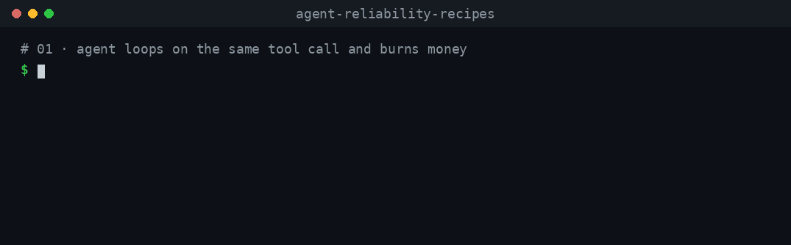

# 01 · Stop an agent that loops and burns money

**The failure:** the agent calls the same tool with the same input again and again. Nothing errors, so nobody notices until the bill arrives.

**The fix:** two small stop conditions for the Vercel AI SDK's `stopWhen` — one stops on repeated identical tool calls, one stops when the run's spend crosses a limit — plus a step cap as the last line of defence. Each guard records *why* it stopped the run.



## Run it (no API key)

```bash
npm install
npm run demo:01
npm test
```

Output of `npm run demo:01`:

```
BROKEN agent
  model calls: 50
  cost:        $0.3375
FIXED agent
  model calls: 3
  cost:        $0.0203
  stopped by:  {"rule":"repeated-tool-call","toolName":"checkOrderStatus","repeats":3}
```

The demo uses a mock model that always asks to check the same order again, and an example price of $3 / $15 per million input / output tokens. Costs are illustrative; use your provider's real prices.

## What goes wrong

The agent is told to report once an order ships. The `checkOrderStatus` tool keeps answering `pending`, so the model keeps asking. Someone raised the step cap "so the agent can finish":

```ts
// src/agent.ts — BROKEN
new ToolLoopAgent({ model, instructions, tools, stopWhen: isStepCount(50) });
```

Every step is another paid model call, and each call re-sends the growing conversation.

## The fix

```ts
// src/agent.ts — FIXED
const guards = createGuards({ maxRepeats: 3, maxCostUsd: 0.1, price });
new ToolLoopAgent({
  model, instructions, tools,
  stopWhen: [isStepCount(20), ...guards.stopWhen],
});
guards.reason(); // which rule fired, or null
```

`stopWhen` accepts an array; the loop stops when **any** condition returns `true`. The guards live in [`src/guards.ts`](src/guards.ts):

| Guard | Stops when | Reports |
| --- | --- | --- |
| Repeated tool call | The last `maxRepeats` tool calls have the same tool name and the same input (key order ignored) | `{ rule: 'repeated-tool-call', toolName, repeats }` |
| Cost limit | Total spend so far, from each step's `usage.inputTokens` / `usage.outputTokens` × your price, is at or above `maxCostUsd` | `{ rule: 'cost-limit', spentUsd, limitUsd }` |
| Step cap | `isStepCount(20)` from the AI SDK | — |

## What the tests prove

[`test/recipe.test.ts`](test/recipe.test.ts) runs everything offline with `MockLanguageModelV4` from `ai/test`:

- The broken agent makes 50 model calls.
- The fixed agent stops after 3 identical calls and reports `repeated-tool-call`.
- When every call is different but expensive, the cost guard stops the run.
- When every call is different and cheap, the step cap stops it at 20.
- A healthy run (one tool call, then an answer) is not affected.
- Inputs with different key order count as the same call.

## Limits — read before using this in production

- **Stop conditions run after a step finishes.** The cost guard can overshoot by up to one step. In the test above, the limit is $0.10 and the run stops at $0.126. For a hard ceiling *before* a call is made, use a pre-call guard such as [budget-guard](https://github.com/kimbeomgyu/budget-guard) or [floe-guard](https://pypi.org/project/floe-guard/).
- **Exact repeats only.** The guard catches identical inputs. An agent that varies one argument each time (`page: 1, 2, 3…`) is caught by the cost limit or the step cap instead. For oscillation and no-progress detection, see [agent-loopguard](https://github.com/OsamaAnsar/agent-loopguard).
- **One run per guard.** Create a new agent with `createFixedAgent` per run, so `reason()` describes that run only.
- **Mastra** has its own built-in [`CostGuardProcessor`](https://mastra.ai/reference/processors/cost-guard-processor.md) and [`TokenCostControl`](https://mastra.ai/reference/processors/token-cost-control); use those there.

## Versions

Tested with `ai@7.0.166` on Node 22. In AI SDK 7 the step-cap helper is `isStepCount`; `stepCountIs` is still exported as an alias of it.

## Files

| File | What it is |
| --- | --- |
| `src/guards.ts` | The two guards and the cost calculation |
| `src/agent.ts` | Broken and fixed agents, and the `checkOrderStatus` tool |
| `src/mock-model.ts` | Offline mock model that loops |
| `src/demo.ts` | Runs both agents and prints the comparison |
| `test/recipe.test.ts` | Tests for every claim on this page |
