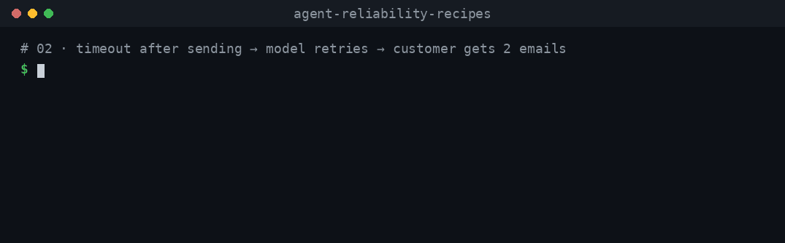

# 02 · Stop a retry from sending the email (or charging the card) twice

**The failure:** the tool sends the email, but the provider's response is lost and the tool sees a timeout. The model reads the error, calls the tool again, and the customer gets two emails. With a payment tool, they get charged twice.

**The fix:** send an **idempotency key** with every side-effecting call, built from the *business intent* ("the shipping email for order A-1001"), so a retry is recognised as the same action and not executed again.



## Run it (no API key)

```bash
npm install
npm run demo:02
npm test
```

Output of `npm run demo:02`:

```
BROKEN agent
  requests to email API: 2
  emails delivered:      2
FIXED agent
  requests to email API: 2
  emails delivered:      1
```

The demo uses a mock model that calls the tool again after an error, as a helpful model would, and a fake email provider that times out after the first send.

## What goes wrong

```ts
// src/agent.ts — BROKEN
execute: async ({ orderId, to }) => api.send(shippingEmail(orderId, to)),
```

1. The tool calls the provider. The email **is sent**.
2. The response never arrives, so `api.send` throws a timeout.
3. The AI SDK passes the error back to the model as the tool's result.
4. The model calls `sendShippingEmail` again with the same input. A second email goes out.

The tool can't tell "it failed" from "it worked but I didn't hear back". Only the provider knows.

## The fix

```ts
// src/agent.ts — FIXED
export function shippingEmailKey(orderId: string) {
  return `shipping-email:${orderId}`;
}

execute: async ({ orderId, to }) =>
  api.send(shippingEmail(orderId, to), { idempotencyKey: shippingEmailKey(orderId) }),
```

The provider stores the result of the first request made with a key. A retry with the same key gets that stored result back and nothing is sent again. [Stripe](https://docs.stripe.com/api/idempotent_requests) works this way for `POST` requests via the `Idempotency-Key` header, and the fake provider in [`src/fake-email-api.ts`](src/fake-email-api.ts) copies that behaviour.

### Choosing the key — the part most people get wrong

| Key | Works? | Why |
| --- | --- | --- |
| `toolCallId` | ❌ | Each retry by the model is a new tool call with a new id. The test proves it. |
| `crypto.randomUUID()` inside `execute` | ❌ | Each retry creates a new UUID. |
| A UUID created once and stored with the order | ✅ | Same key on every retry, as long as you read it back from storage. |
| Built from the intent: `shipping-email:${orderId}` | ✅ | Same for every attempt at this action, different for a different action. |

Keep personal data out of keys — Stripe advises against using emails or personal identifiers.

## What the tests prove

[`test/recipe.test.ts`](test/recipe.test.ts):

- Broken: a timeout after sending leads to 2 requests and 2 delivered emails.
- Fixed: 2 requests, **1** delivered email; the retry receives the first send's result (`msg_1`).
- The two attempts have different `toolCallId`s, so `toolCallId` can't be the key.
- Two different orders still get two emails — the key doesn't block legitimate actions.
- A healthy run makes exactly one request.
- Reusing a key with different parameters is rejected (Stripe does the same).

## Limits — read before using this in production

- **The receiving service must honour the key.** Check your provider's docs. If it doesn't, record the key in your own database with a unique constraint *before* calling, and treat "sent but no response" as unknown, not failed.
- **Keys expire.** Stripe may remove keys once they are at least 24 hours old; a retry after that is a new request.
- **Doing the same thing on purpose twice needs a new key.** A second reminder email must use a different key (for example `reminder:${orderId}:2`).
- **Durable workflows still need this.** Vercel's [durable agents guide](https://vercel.com/kb/guide/durable-ai-agents) notes that an interrupted step can repeat an external action, and recommends an idempotency key enforced by the receiving service.

## Versions

Tested with `ai@7.0.166` on Node 22.

## Files

| File | What it is |
| --- | --- |
| `src/agent.ts` | Broken and fixed agents, and `shippingEmailKey` |
| `src/fake-email-api.ts` | Offline email provider with idempotency keys and a lost-response timeout |
| `src/mock-model.ts` | Offline mock model that retries after a tool error |
| `src/demo.ts` | Runs both agents and prints the comparison |
| `test/recipe.test.ts` | Tests for every claim on this page |
